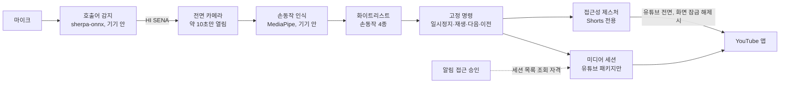

# Sena Cue 보안 점검 보고서

카메라와 마이크로 유튜브 재생을 제어하는 Android 앱 Sena Cue의 보안 점검 결과와 조치 기록입니다.

| 항목 | 내용 |
|---|---|
| 대상 | Sena Cue (`com.example.youtubegesturecontrol`) 1.1.0 |
| 플랫폼 | Android, minSdk 26 (Android 8.0) / targetSdk 37 |
| 점검일 | 2026-11-23 |
| 범위 | 앱 소스 전체(Kotlin, 매니페스트, 리소스, Gradle 설정), 서드파티 의존성이 병합하는 권한·컴포넌트와 그 동작 |
| 결과 | 조치 6건(그중 1건은 부분 완화), 배포 전 조치 필요 1건, 해당 없음 확인 13개 영역. 위험도 높음 등급은 없음 |

## 목차

1. [요약](#1-요약)
2. [앱 구조와 위협 모델](#2-앱-구조와-위협-모델)
3. [점검 방법](#3-점검-방법)
4. [결과 요약](#4-결과-요약)
5. [수정한 항목](#5-수정한-항목)
6. [해당 없음으로 확인한 항목](#6-해당-없음으로-확인한-항목)
7. [검토했지만 바꾸지 않은 항목](#7-검토했지만-바꾸지-않은-항목)
8. [잔여 위험](#8-잔여-위험)
9. [검증](#9-검증)
10. [변경 파일](#10-변경-파일)
11. [향후 권장 사항](#11-향후-권장-사항)
12. [참고 자료](#12-참고-자료)

## 1. 요약

Sena Cue는 카메라, 마이크, 알림 접근, 접근성 서비스, 다른 앱 위 표시 권한을 함께 사용합니다. 그래서 외부 입력을 통한 공격보다는 "권한이 필요 이상으로 넓지 않은가", "민감한 데이터가 새지 않는가"가 핵심 점검 대상이었습니다.

- **입력 기반 공격은 구조적으로 해당 없음.** WebView와 HTML 렌더링이 없어 XSS가 성립하지 않습니다. 카메라 경로에는 QR 디코더, 글자 인식, 언어 모델이 없어 QR 주입이나 이미지 속 글자를 이용한 프롬프트 인젝션도 성립하지 않습니다. 카메라에 무엇을 비추든 결과는 손동작 4종 중 하나이거나 "없음"입니다.
- **서드파티 SDK가 넣은 네트워크 권한과 사용 통계 전송을 발견해 차단.** MediaPipe가 Google 통계 전송 라이브러리를 통해 `INTERNET` 권한을 병합하고 있었습니다. 앱 기능은 네트워크를 쓰지 않으므로 권한을 제거했습니다. 이제 카메라·마이크 데이터가 앱 밖으로 나갈 경로가 OS 수준에서 막힙니다.
- **필요 이상의 데이터 수신 축소.** 로그에 남던 미디어 제목·ID를 지우고, 알림 리스너가 알림 본문을 받지 않도록 제한했습니다.
- **방어 심층화.** 잠금 화면에 제스처를 보내지 않도록 막고, 태스크 하이재킹을 부분 완화하고, 의존성 저장소 범위를 좁혔습니다.
- **검증.** 디버그 빌드, 단위 테스트 82개, 병합 매니페스트를 확인했습니다. 서드파티 바이트코드와 AOSP 소스로 조치의 부작용이 없음을 확인했습니다. 실기기 확인은 남아 있습니다.

## 2. 앱 구조와 위협 모델

### 2.1 데이터 흐름



음성과 영상은 기기 안에서만 처리됩니다. 이 앱이 다른 앱에 보내는 것은 유튜브 앱에 대한 재생 명령 4가지뿐입니다.

### 2.2 민감 권한과 용도

| 권한·기능 | 용도 | 제한 |
|---|---|---|
| `CAMERA` | 손동작 인식 | 호출어 뒤 약 10초만 열림, 프레임 저장 안 함 |
| `RECORD_AUDIO` | 호출어 감지 | 기기 안에서만 처리, 저장 안 함 |
| 알림 접근 | 다른 앱의 미디어 세션 목록 조회 자격 | 알림 내용은 쓰지 않음 |
| 접근성 서비스 | Shorts용 탭·스와이프 | 전면 앱의 패키지 이름만 읽음 |
| `SYSTEM_ALERT_WINDOW` | 호출어 감지 배너 | 선택 사항, 터치·포커스 받지 않음 |
| `POST_NOTIFICATIONS` | 상태 알림과 중지 버튼 | 앱 자신의 알림만 게시 |
| `FOREGROUND_SERVICE_CAMERA`, `FOREGROUND_SERVICE_MICROPHONE` | 백그라운드 제어 서비스 | 앱 화면이 보일 때만 시작 |

### 2.3 공격자 모델

| 공격자 | 가정한 행동 |
|---|---|
| 같은 기기에 설치된 악성 앱 | Intent 전송, 화면 위 오버레이, 태스크 하이재킹 |
| 기기 앞의 사람 | 카메라에 이미지·QR·글자 보여 주기, 호출어 말하기 |
| 악성 콘텐츠 | 유튜브 영상의 소리, 화면에 뜬 글자 |
| 로그 접근자 | adb나 버그 리포트로 logcat 열람 |
| 공급망 | 의존성 저장소나 빌드 산출물 변조 |

## 3. 점검 방법

- **소스 전수 검토.** `app/src/main`의 Kotlin 파일 전부, 매니페스트, 레이아웃, 문자열 리소스, 백업 규칙, 접근성 설정, Gradle 설정을 읽었습니다.
- **위험 API 검색.** WebView, `Html.fromHtml`, Linkify, Intent 파싱(`parseUri`, `get*Extra`), 동적 브로드캐스트 리시버, 파일·외부 저장소 쓰기, 네트워크, 프로세스 실행, 바코드 라이브러리를 찾고 `Log.*` 호출을 모두 확인했습니다.
- **병합 매니페스트 분석.** 라이브러리가 넣는 권한과 컴포넌트를 빌드 결과물에서 확인했습니다.
- **의존성 분석.** MediaPipe의 POM과 AAR 매니페스트를 열어 전이 의존성과 선언 권한을 추적했습니다.
- **바이트코드 분석.** JDK의 `javap`로 MediaPipe 통계 로거와 datatransport 실행기의 실제 동작을 확인했습니다.
- **AOSP 소스 확인.** 알림 유형 필터와 미디어 세션 권한 검사를 `frameworks/base` 원본 코드로 확인했습니다.
- **모델 파일 확인.** `gesture_recognizer.task` 안에 어떤 모델이 들어 있는지 확인했습니다.
- **수정 후 검증.** 디버그 빌드, 단위 테스트, lint, 병합 매니페스트를 다시 확인했습니다.

## 4. 결과 요약

위험도 기준은 다음과 같습니다.

- **높음:** 다른 앱이나 원격에서 추가 조건 없이 민감 데이터나 권한을 얻을 수 있음.
- **중간:** 민감 데이터 노출이나 과도한 권한이 있지만, 악용하려면 adb 접근, 의존성 침해, 외부 배포 같은 추가 조건이 필요함.
- **낮음:** 여러 조건이 겹쳐야 하고 피해가 제한적이거나, 방어 심층화 성격.

| ID | 항목 | 위험도 | 상태 |
|---|---|---|---|
| SEC-01 | 로그에 미디어 제목·ID 기록 | 중간 | 수정 |
| SEC-02 | 서드파티가 병합한 `INTERNET` 권한과 사용 통계 전송 | 중간 | 수정 |
| SEC-03 | 알림 리스너가 모든 알림 내용 수신 | 중간 | 수정 |
| SEC-04 | 잠금 화면·꺼진 화면에 접근성 제스처 전달 가능 | 낮음 | 수정 |
| SEC-05 | Android 8–10에서 태스크 하이재킹(StrandHogg) 노출 | 낮음 | 부분 완화 |
| SEC-06 | JitPack 저장소 범위 무제한 | 낮음 | 수정 |
| SEC-07 | release 빌드가 debug 키로 서명됨 | 중간(외부 배포 시) | 보류, 배포 전 조치 필요 |

## 5. 수정한 항목

### SEC-01. 로그에 미디어 제목·ID 기록

- **위험도:** 중간
- **분류:** CWE-532, OWASP MASVS-STORAGE
- **위치:** `media/YoutubeController.kt`의 `logSession`, `logDispatchStart`, `logResult`

**문제.** Shorts 디버깅용 로그가 활성 미디어 세션 전부의 제목과 mediaId를 그대로 logcat에 남겼습니다. 유튜브뿐 아니라 음악이나 팟캐스트 같은 다른 앱의 세션도 포함됐습니다. 다음·이전 명령에서는 바뀌기 전후의 영상 식별자(ID 또는 제목)까지 기록했습니다.

**영향.** Android 4.1부터 일반 앱은 다른 앱의 logcat을 읽을 수 없습니다. 하지만 adb 접근자, 버그 리포트, 제조사 로그 수집기에는 사용자의 시청·청취 기록이 남습니다.

**조치.** 원문을 지우고 디버깅에 필요한 판정 정보만 남겼습니다. Shorts 판정은 제목과 ID가 비었는지만 보므로 원문은 필요하지 않습니다.

```kotlin
// 변경 전
"hasTitle=${!identity.title.isNullOrEmpty()} mediaId=${identity.mediaId} " +
    "title=${identity.title}",
" beforeIdentity=$beforeIdentity afterIdentity=$afterIdentity"

// 변경 후
"hasTitle=${!identity.title.isNullOrEmpty()}",
" hasBeforeIdentity=${beforeIdentity != null} hasAfterIdentity=${afterIdentity != null} " +
    "identityChanged=${MediaIdentity.changed(beforeIdentity, afterIdentity)}"
```

**기능 영향.** 없습니다. 로그 문구만 바뀌었습니다.

### SEC-02. 서드파티가 병합한 INTERNET 권한과 사용 통계 전송

- **위험도:** 중간
- **분류:** CWE-250, OWASP MASVS-PRIVACY
- **위치:** `AndroidManifest.xml`

**문제.** 앱 매니페스트에는 `INTERNET`이 없었지만 최종 APK에는 들어가 있었습니다. 병합 경로는 다음과 같습니다.

```text
com.google.mediapipe:tasks-vision:1.1.1
└─ com.google.mediapipe:tasks-core:1.1.1
   ├─ com.google.android.datatransport:transport-api:3.0.0
   ├─ com.google.android.datatransport:transport-runtime:3.1.0      → ACCESS_NETWORK_STATE
   └─ com.google.android.datatransport:transport-backend-cct:3.1.0  → INTERNET, ACCESS_NETWORK_STATE
```

MediaPipe의 `TasksStatsProtoLogger`와 `RemoteLoggingClient`는 이 라이브러리로 Google에 사용 통계를 보냅니다. 바이트코드에서 확인한 전송 필드는 다음과 같습니다.

- 시스템 정보: 플랫폼, 앱 ID(패키지 이름), 앱 버전, MediaPipe 버전, OS 버전, 실행 환경
- 이벤트: 세션 시작·종료, 실행 모드, 그래프 이름, 초기화 지연, 평균·최대 처리 지연, 처리·누락 횟수, 오류 코드

이미지, 음성, 손 좌표, 인식 결과를 담는 필드는 없습니다. 통계 로거를 만드는 `TasksStatsLoggerFactory`는 항상 원격 로거를 만들고, 앱에서 이를 끄는 공개 옵션은 찾지 못했습니다.

**영향.** README의 "음성과 손 인식은 폰 안에서 이루어진다"는 안내는 사실이지만, 앱 ID와 사용 통계가 Google로 전송되는 구조라는 점은 안내되지 않았습니다. 더 중요한 점은, 카메라·마이크·알림·화면 접근 권한을 가진 프로세스에 네트워크 권한이 있으면 의존성 하나가 변조됐을 때 그대로 데이터 유출 경로가 된다는 것입니다.

**조치.** 매니페스트 병합 단계에서 권한을 제거했습니다.

```xml
<uses-permission
    android:name="android.permission.INTERNET"
    tools:node="remove" />
```

**기능 영향.** 없습니다. 앱 기능 중 네트워크를 쓰는 것이 없습니다. 통계 전송이 실패해도 앱이 죽지 않는지는 다음과 같이 확인했습니다.

- `RemoteLoggingClient`는 생성 시 전송 객체만 만들고, 로그는 `Transport.send()`로 비동기 대기열에 넘깁니다. 인식기 초기화 경로에서 네트워크를 쓰지 않습니다.
- datatransport의 백그라운드 실행기는 `ExecutionModule.executor()`가 만드는 `SafeLoggingExecutor`입니다. 그 `SafeLoggingRunnable.run()`은 `java.lang.Exception`을 잡아 로그만 남깁니다.

보내지 못한 통계는 라이브러리 내부 대기열에 남을 수 있습니다. 민감 정보가 아니고 백업에서도 제외됩니다. `ACCESS_NETWORK_STATE`는 데이터 접근이 없는 일반 권한이고 datatransport가 네트워크 상태 조회에 쓰므로 남겼습니다. 나중에 네트워크 기능을 추가하면 이 항목을 지우고 네트워크 보안 설정을 함께 검토해야 합니다.

### SEC-03. 알림 리스너가 모든 알림 내용 수신

- **위험도:** 중간
- **분류:** CWE-250, OWASP MASVS-PRIVACY
- **위치:** `AndroidManifest.xml`의 `MediaNotificationListener`

**문제.** 알림 리스너는 `MediaSessionManager.getActiveSessions()`를 호출할 자격을 얻으려고 둔 것이고, 알림 내용은 쓰지 않습니다. 그런데 시스템은 기기의 모든 알림(메시지, 인증번호 등)을 이 앱 프로세스로 전달하고 있었습니다.

**영향.** 쓰지 않는 민감 데이터가 프로세스 메모리에 들어옵니다. 프로세스가 침해되면 노출되고, 알림마다 전달·처리 비용도 생깁니다.

**조치.** Android 12(API 31)에 추가된 알림 유형 필터의 기본값을 0으로 지정해, 어떤 유형의 알림도 받지 않게 했습니다.

```xml
<meta-data
    android:name="android.service.notification.default_filter_types"
    android:value="0" />
```

**근거.** AOSP `frameworks/base` main 브랜치 소스로 다음을 확인했습니다.

- 미디어 세션 권한 검사는 `MediaSessionService.enforceMediaPermissions()`에서 `NotificationManagerService.hasEnabledNotificationListener()`를 거쳐 `mListeners.isPackageAllowed()`로 이어집니다. 알림 접근 **승인 여부**만 보고 유형 필터는 보지 않습니다.
- `ensureFilters()`는 메타데이터 값을 `toString()`으로 읽고, `getTypesFromStringList("0")`은 0을 돌려줍니다.
- `isVisibleToListener()`는 `isTypeAllowed()`로 알림 유형을 거릅니다. 허용 유형이 0이면 어떤 알림도 전달되지 않습니다.

**기능 영향.** 없습니다. 참고 사항은 다음과 같습니다.

- Android 11 이하는 이 메타데이터를 무시합니다. 앱은 원래 알림을 처리하지 않습니다.
- 사용자가 설정에서 필터를 직접 바꾼 적이 있으면 그 값이 유지됩니다.
- 설정 → 알림 접근 → Sena Cue의 "허용된 알림 유형"이 모두 꺼져 보이는 것은 정상입니다.

### SEC-04. 잠금 화면·꺼진 화면에 접근성 제스처 전달 가능

- **위험도:** 낮음
- **분류:** 방어 심층화, OWASP MASVS-PLATFORM
- **위치:** `accessibility/YoutubeGestureAccessibilityService.kt`, `accessibility/ShortsAccessibilityPolicy.kt`

**문제.** Shorts용 탭·스와이프를 보내기 전 확인은 "접근성 서비스가 보는 전면 창이 유튜브인가" 하나였습니다. 기기나 OS 구현에 따라 잠금 화면 위에서도 전면 창이 유튜브로 보고될 수 있는데, 그러면 화면 중앙 탭이나 세로 스와이프가 잠금 화면에 전달됩니다.

**영향.** 보안 잠금이 설정돼 있으면 스와이프해도 PIN 입력 화면이 뜰 뿐 잠금이 풀리지는 않습니다. 다만 시스템 화면에 의도하지 않은 입력이 들어갑니다.

**조치.** 두 번째 관문을 추가했습니다. 판단 로직은 기존 구조대로 Android에 의존하지 않는 정책 객체에 두고 단위 테스트를 붙였습니다. 시스템 서비스를 얻지 못하면 보내지 않는 쪽(fail-closed)으로 처리합니다.

```kotlin
// ShortsAccessibilityPolicy
fun isScreenUnlocked(interactive: Boolean, keyguardLocked: Boolean): Boolean {
    return interactive && !keyguardLocked
}

// YoutubeGestureAccessibilityService
private fun screenUnlocked(): Boolean {
    val power = getSystemService(PowerManager::class.java) ?: return false
    val keyguard = getSystemService(KeyguardManager::class.java) ?: return false
    return ShortsAccessibilityPolicy.isScreenUnlocked(
        interactive = power.isInteractive,
        keyguardLocked = keyguard.isKeyguardLocked,
    )
}
```

**기능 영향.** 화면이 켜져 있고 잠금이 풀린 상태로 유튜브를 보는 정상 사용에서는 없습니다. 차단되면 기존 안내 "유튜브가 앞에 있지 않아 제스처를 보내지 않았습니다"가 표시되고, 로그에 `why=screen-locked`가 남습니다.

### SEC-05. Android 8–10에서 태스크 하이재킹(StrandHogg) 노출

- **위험도:** 낮음
- **분류:** OWASP MASVS-PLATFORM
- **위치:** `AndroidManifest.xml`의 `MainActivity`

**문제.** 악성 앱이 자기 화면의 `taskAffinity`를 이 앱의 패키지 이름으로 맞추면, 사용자가 이 앱을 열 때 가짜 화면을 위에 띄울 수 있습니다(StrandHogg). 이 앱은 접근성과 알림 접근 허용을 안내하는 앱이라, 같은 안내를 흉내 내 악성 앱의 권한을 받아 내는 피싱에 이용될 수 있습니다.

**적용 범위.** Android 개발자 문서에 따르면 Android 11(API 30) 이상은 OS 패치로 이 공격을 막습니다. 이 앱은 minSdk 26이라 Android 8–10 기기에도 설치됩니다.

**조치.** 문서가 권장하는 완전한 대책은 minSdk를 30으로 올리는 것이지만, 그러면 Android 8–10 사용자가 앱을 설치할 수 없습니다. 그래서 앱 설정으로 가능한 부분 완화(버전 1 대응)로 `MainActivity`의 친화성을 비웠습니다.

```xml
<activity
    android:name=".MainActivity"
    android:exported="true"
    android:taskAffinity="">
```

**기능 영향.** 화면이 하나뿐이고, 런처나 알림으로 다시 열 때 시스템이 기존 작업을 실행 컴포넌트 기준으로 찾아 재사용하므로 영향이 없을 것으로 예상합니다. 실기기 확인 목록에 넣었습니다.

### SEC-06. JitPack 저장소 범위 무제한

- **위험도:** 낮음
- **분류:** CWE-829, 공급망
- **위치:** `settings.gradle.kts`

**문제.** JitPack은 GitHub 소스를 요청 시점에 빌드해 배포하는 저장소입니다. 범위를 제한하지 않으면, 앞 순서의 저장소(Google, Maven Central)에 없는 의존성은 모두 JitPack에서 찾습니다.

**조치.** sherpa-onnx 그룹만 허용했습니다.

```kotlin
maven {
    url = uri("https://jitpack.io")
    content { includeGroupByRegex("com\\.github\\.k2-fsa.*") }
}
```

**검증.** 로컬 캐시에 없던 sherpa-onnx가 이 제한을 건 상태에서 새로 내려받아졌고, 빌드가 성공했습니다. JitPack 의존성을 새로 추가할 때는 여기에 그룹을 더해야 합니다.

### SEC-07. release 빌드가 debug 키로 서명됨 (보류)

- **위험도:** 중간(외부 배포 시)
- **상태:** 보류, 배포 전 조치 필요
- **위치:** `app/build.gradle.kts`의 `signingConfig = signingConfigs.getByName("debug")`

**문제.** debug 키스토어는 개발 PC마다 자동으로 만들어지고 비밀번호가 `android`로 공개돼 있습니다. 이 APK를 외부에 배포하면 키스토어 파일을 손에 넣은 사람이 같은 서명으로 악성 업데이트를 만들 수 있습니다. Google Play도 debug 키로 서명한 APK를 받지 않습니다. 단, release 빌드 유형은 `debuggable`이 아니므로 디버거 연결 문제는 없습니다.

**보류 이유.** 개발용 폰에 설치된 debug 앱 위에 release 빌드를 덮어 설치하기 위한 의도된 설정입니다. 키를 바꾸면 기존 앱을 지우고 다시 설치해야 해서 사용 중인 설정이 사라집니다.

**배포 전 조치.** 별도 업로드 키를 만들어 저장소 밖(`local.properties`나 환경 변수)에서 읽고, Play App Signing을 사용합니다.

## 6. 해당 없음으로 확인한 항목

### 6.1 XSS와 HTML 주입

- WebView, `loadUrl`, `addJavascriptInterface`가 없습니다.
- `Html.fromHtml`, `Linkify`, `android:autoLink`, `LinkMovementMethod`가 없어서 텍스트가 HTML이나 링크로 해석되지 않습니다.
- 화면과 알림에 표시되는 외부 문자열은 미디어 세션의 패키지 이름과 예외 메시지뿐이고, 모두 일반 텍스트입니다. 영상 제목은 화면에 표시하지 않습니다.
- 문자열 리소스에 HTML 태그가 없습니다. 포맷 문자열은 모두 리소스에 고정된 위치 인자(`%1$s`)라서 외부 값이 포맷 문자열이 될 수 없습니다.

### 6.2 카메라 입력: QR 코드 주입

QR 공격은 앱이 QR 안의 URL이나 데이터를 꺼내 쓸 때 성립합니다. 이 앱에는 바코드 라이브러리가 없고, `gesture_recognizer.task` 안의 모델도 손 인식용 네 개뿐입니다.

| 모델 | 역할 |
|---|---|
| `hand_detector.tflite` | 프레임에서 손의 위치를 찾음 |
| `hand_landmarks_detector.tflite` | 손 관절 21개의 좌표를 계산 |
| `gesture_embedder.tflite` | 관절 좌표를 특징 벡터로 바꿈 |
| `canned_gesture_classifier.tflite` (7.7KB) | 특징 벡터를 정해진 손동작 이름으로 분류 |

QR은 흑백 무늬로만 처리되고, 손이 감지되지 않으면 결과는 "없음"입니다.

### 6.3 카메라 입력: 이미지 속 글자(시각적 프롬프트 인젝션)

"이전 지시를 무시하고 ~하라" 같은 글자를 보여 주는 공격은 이미지 속 글자를 읽고 그 뜻대로 행동하는 시스템(OCR과 명령 처리, 멀티모달 LLM)을 노립니다. 이 앱에는 글자 인식도 언어 모델도 없고, 분류기의 출력은 문장이 아니라 손동작 이름 하나입니다. 그 이름이 명령이 되기까지의 경로도 모두 고정돼 있습니다.

1. `HandGesture.fromModelName()`이 `Open_Palm`, `Thumb_Up`, `Thumb_Down`, `Closed_Fist`만 통과시키고 나머지는 버립니다.
2. `ControlStateMachine.playbackCommandFor()`가 각각을 일시정지·재생·다음·이전 enum으로 바꿉니다.
3. 명령은 `YoutubeSessionSelector`가 고른 `com.google.android.youtube` 세션이나, 유튜브가 전면일 때의 고정 좌표 제스처로만 전달됩니다.

화면에 뜬 글자도 마찬가지입니다. 접근성 서비스는 화면 글자를 읽지 않고 전면 창의 패키지 이름만 확인하며, `onAccessibilityEvent`는 아무 일도 하지 않습니다. 유튜브 영상에 악성 문구가 떠도 앱 동작에 영향이 없습니다.

### 6.4 조작된 이미지로 네이티브 코드 공격

이미지 파일(JPEG, PNG)이나 바코드를 해석하는 코드의 메모리 버그를 노리는 공격은 공격자가 파일 구조를 조작할 수 있을 때 성립합니다. 이 앱은 CameraX가 넘겨준 고정 크기 RGBA 픽셀을 복사·회전·축소(긴 변 256픽셀)해 모델에 넣을 뿐, 파일 형식을 해석하지 않습니다. 공격자가 바꿀 수 있는 것은 렌즈로 들어오는 빛뿐입니다.

### 6.5 컴포넌트 노출과 IPC

병합 매니페스트 기준으로 외부에 노출된 컴포넌트는 네 개입니다. 런처 화면을 빼면 모두 시스템만 가진 권한으로 보호됩니다.

| 컴포넌트 | 보호 |
|---|---|
| `MainActivity` | 런처 진입점. Intent의 extra와 data를 읽지 않음 |
| `MediaNotificationListener` | `BIND_NOTIFICATION_LISTENER_SERVICE` |
| `YoutubeGestureAccessibilityService` | `BIND_ACCESSIBILITY_SERVICE` |
| `androidx.profileinstaller.ProfileInstallReceiver` | `android.permission.DUMP` |

제어 서비스(`ControlService`), datatransport 컴포넌트, AndroidX 초기화 제공자 등 나머지는 모두 `exported="false"`입니다. 앱 코드에는 동적 브로드캐스트 리시버와 콘텐츠 제공자가 없습니다.

### 6.6 PendingIntent

알림의 "앱 열기"와 "제어 중지"는 대상 클래스를 지정한 명시적 Intent에 `FLAG_IMMUTABLE`을 붙였습니다. 다른 앱이 내용을 바꾸거나 가로챌 수 없습니다.

### 6.7 오버레이 배너

호출어 배너는 `FLAG_NOT_TOUCHABLE`과 `FLAG_NOT_FOCUSABLE`로 터치와 키 입력을 받지 않고, 고정 문구를 2.2초만 보여 줍니다. 다른 앱의 입력을 가로채는 탭재킹 수단이 될 수 없습니다.

### 6.8 데이터 저장과 백업

- 앱 코드가 저장하는 데이터는 `MODE_PRIVATE` SharedPreferences 두 개(권한 요청 여부, 화면 모드)뿐이고 민감 정보가 없습니다.
- 앱 코드는 파일, 데이터베이스, 외부 저장소에 직접 쓰지 않습니다. 라이브러리 내부 저장소(AppCompat의 언어 설정, datatransport의 통계 대기열)에도 민감 정보가 없습니다.
- `allowBackup="false"`이고, 백업 규칙과 기기 간 전송 규칙이 모든 영역을 제외합니다.

### 6.9 카메라·마이크 프라이버시

- 카메라는 호출어를 들은 뒤에만 열리고, 손동작이 확정되거나 10초 제한 시간이 지나면 닫힙니다. 호출어를 기다리는 동안에는 카메라를 바인드하지 않습니다.
- 프레임은 메모리의 복사본으로만 처리하고, 추론이 끝나면 비트맵을 해제합니다. 파일로 저장하지 않습니다.
- 오디오는 호출어 모델에만 넣고 저장하지 않습니다.
- 서비스는 `START_NOT_STICKY`라서 프로세스가 죽은 뒤 백그라운드에서 카메라·마이크를 저절로 다시 열지 않습니다.
- SEC-02 조치로 이 데이터가 네트워크로 나갈 경로 자체가 없습니다.

### 6.10 접근성 서비스 범위

- 화면에서 읽는 정보는 전면 창의 패키지 이름 하나이고, 읽은 노드는 바로 해제합니다.
- 제스처는 화면 비율로 정한 고정 좌표(중앙 탭, 세로 스와이프)뿐이라 외부 입력이 좌표를 정할 수 없습니다.
- `isAccessibilityTool`은 기본값(false)입니다. Android 14 이상에서는 앱들이 민감하다고 표시한 화면 요소가 이 서비스에 보이지 않습니다.
- 서비스는 시스템만 바인드할 수 있고, 제스처 함수는 앱 내부에서만 호출됩니다.

### 6.11 패키지 가시성

`<queries>`에 유튜브 패키지 하나만 선언했고, `QUERY_ALL_PACKAGES`를 쓰지 않습니다.

### 6.12 현재 작업 트리의 비밀값

`assets`에는 모델과 키워드·토큰 파일만 있습니다. `.gitignore`에 적힌 `wake_word.properties`와 Porcupine 키 파일은 없고, 현재 호출어 엔진(sherpa-onnx)은 API 키가 필요 없습니다. 과거 git 기록은 9.5절에 적은 대로 확인하지 못했습니다.

### 6.13 모델 파일 무결성

모델은 APK 안의 `assets`에서만 읽으므로 APK 서명으로 무결성이 보장됩니다. 실행 중에 외부에서 모델을 내려받지 않습니다.

## 7. 검토했지만 바꾸지 않은 항목

- **`filterTouchesWhenObscured`(가려진 화면의 터치 무시).** 블루라이트 필터 같은 화면 오버레이 앱을 쓰는 사용자는 버튼이 눌리지 않게 됩니다. Android 12 이상은 다른 앱의 불투명한 오버레이를 통과하는 터치를 시스템이 이미 막고, 실제 권한 부여는 모두 시스템 화면에서 이뤄지므로 적용하지 않았습니다.
- **접근성 `packageNames` 제한.** 이 속성은 이벤트 전달만 거르고 화면 내용 조회는 막지 않습니다. 이 앱은 이벤트를 원래 무시하므로 효과 없이 동작 위험만 생깁니다.
- **`canRetrieveWindowContent` 제거.** 현재 구현은 창의 루트 노드에서 전면 앱의 패키지 이름을 얻으므로 이 권한이 필요합니다. 코드는 패키지 이름만 읽습니다.
- **`ACCESS_NETWORK_STATE` 제거.** 데이터 접근이 없는 일반 권한입니다. datatransport가 네트워크 상태를 조회하므로 지우면 라이브러리의 예외 경로만 늘어납니다.
- **minSdk 30 상향.** StrandHogg를 완전히 막지만 Android 8–10 사용자가 설치할 수 없게 됩니다(SEC-05).
- **로그의 패키지 이름.** 전면 앱과 미디어 세션의 패키지 이름은 콘텐츠가 아닌 식별자이고 Shorts 디버깅에 필요해서 남겼습니다.
- **의존성 체크섬 검증(`verification-metadata.xml`).** 공급망 방어에 효과적이지만, 의존성을 바꿀 때마다 갱신해야 해서 개인 프로젝트에는 유지 부담이 큽니다. 권장 사항으로 남깁니다.
- **코드 난독화(minify).** 공개 저장소의 앱이라 보안 통제로서 의미가 작고, 네이티브 라이브러리용 규칙 정리가 먼저 필요해서 그대로 둡니다.
- **손동작 라이브니스 검사.** 사진 속 손을 걸러낼 수 있지만 인식률이 떨어집니다. 막는 피해가 재생 제어 수준이라 사용성 손실이 더 큽니다.

## 8. 잔여 위험

- **손 사진으로 손동작 흉내.** 기기 앞에서 호출어를 말하고 손 사진을 보여 주면 명령이 갈 수 있습니다. 카메라는 호출어 뒤 약 10초만 열리고, 같은 모양이 신뢰도 0.7 이상(손바닥은 0.55)으로 0.25초 넘게 유지돼야 합니다. 결과는 유튜브 재생 제어 4가지뿐입니다.
- **소리로 호출어 유도.** 스피커나 유튜브 영상에서 나온 "HI SENA" 소리로 카메라가 열릴 수 있습니다. 폰 화면은 전면 카메라에 비치지 않으므로 영상만으로 손동작까지 넣기는 어렵습니다. 프레임은 저장·전송되지 않고, Android 12 이상에서는 카메라 사용 표시가 뜹니다.
- **전면 앱 확인과 제스처 사이의 짧은 틈.** 확인 직후 수 밀리초 안에 다른 창이 앞에 오면 고정 좌표 입력이 그 창에 갈 수 있습니다. 공격자가 시점을 맞추기 어렵고, 고정 좌표 입력 하나라서 권한 상승으로 이어지지 않습니다.
- **Android 11 이하의 알림 수신.** 알림 유형 필터가 없어 알림이 계속 전달됩니다. 앱은 알림을 처리하지 않습니다.
- **StrandHogg 버전 2.** 앱 설정으로는 막을 수 없고, 기기의 OS 보안 패치에 달려 있습니다.
- **JitPack 빌드 산출물.** 그룹 제한과 네트워크 차단으로 영향은 줄였지만, 산출물 자체의 무결성(체크섬)은 검증하지 않습니다.

## 9. 검증

### 9.1 빌드와 테스트

```powershell
.\gradlew.bat :app:testDebugUnitTest :app:assembleDebug
.\gradlew.bat :app:lintDebug
```

- 디버그 빌드에 성공했습니다.
- 단위 테스트 12개 클래스, 82개가 모두 통과했습니다. SEC-04를 위해 추가한 `ShortsAccessibilityPolicyTest.lockedOrDarkScreenNeverReceivesGestures`도 포함됩니다.
- lint 오류는 없습니다. 경고 18건은 모두 이번에 바꾸지 않은 파일의 기존 항목입니다. 의존성 새 버전 알림 7건, 아이콘·레이아웃·Kotlin 확장 함수 권고 11건이고, 보안 범주 경고는 없습니다.
- 변경한 파일의 IDE 진단 오류는 없습니다.

### 9.2 병합 매니페스트

`app/build/intermediates/merged_manifest/debug/processDebugMainManifest/AndroidManifest.xml`에서 확인했습니다.

- 최종 권한: `CAMERA`, `RECORD_AUDIO`, `POST_NOTIFICATIONS`, `SYSTEM_ALERT_WINDOW`, `VIBRATE`, `FOREGROUND_SERVICE`, `FOREGROUND_SERVICE_CAMERA`, `FOREGROUND_SERVICE_MICROPHONE`, `ACCESS_NETWORK_STATE`, AndroidX가 정의하는 앱 내부 서명 권한(`DYNAMIC_RECEIVER_NOT_EXPORTED_PERMISSION`). `INTERNET`은 없습니다.
- `MainActivity`에 `taskAffinity=""`, `MediaNotificationListener`에 `default_filter_types=0`이 들어갔습니다.
- 외부 노출 컴포넌트는 6.5절 표의 네 개입니다.

### 9.3 서드파티 동작

`javap`로 다음을 확인했습니다.

- `TasksStatsLoggerFactory.create()`는 항상 `TasksStatsProtoLogger.create()`를 호출합니다.
- `RemoteLoggingClient` 생성자는 `TransportRuntime.initialize()`, `newFactory()`, `getTransport()`만 호출하고, `logEvent()`는 `Transport.send()`를 호출합니다.
- `ExecutionModule.executor()`는 `new SafeLoggingExecutor(Executors.newSingleThreadExecutor())`를 돌려줍니다.
- `SafeLoggingExecutor$SafeLoggingRunnable.run()`의 예외 표에 `java.lang.Exception` 처리기가 있습니다.
- 통계 프로토콜 메시지(`SystemInfo`, `SolutionEvent`, `SolutionSessionStart`, `SolutionInvocationReport` 등)의 필드는 SEC-02에 적은 것이 전부입니다.

### 9.4 AOSP 동작

`frameworks/base` main 브랜치에서 `MediaSessionService.enforceMediaPermissions()`, `NotificationManagerService.hasEnabledNotificationListener()`, `ensureFilters()`, `getTypesFromStringList()`, `isVisibleToListener()`를 확인했습니다. 내용은 SEC-03의 근거에 적었습니다.

### 9.5 확인하지 못한 것

- **실기기 동작.** 빌드, 테스트, 정적 분석으로 확인했고 실제 폰에서는 아직 실행하지 않았습니다.
- **git 기록의 비밀값.** `.gitignore`에 예전 Porcupine AccessKey 파일 흔적이 있지만, 기록 전체에서 그 키가 커밋된 적이 있는지는 확인하지 못했습니다.

### 9.6 실기기 확인 목록

1. 권한 요청, 알림 접근 설정, 제어 시작이 정상인지 확인합니다.
2. 일반 영상에서 손바닥(일시정지), 엄지 올림(재생), 엄지 내림(다음), 주먹(이전)이 동작하는지 확인합니다.
3. Shorts에서 접근성 제스처(탭, 위·아래 스와이프)가 동작하는지 확인합니다.
4. 화면을 잠근 상태에서 Shorts 명령을 시도하면 제스처가 가지 않고 안내가 뜨는지 확인합니다.
5. 홈으로 나갔다가 아이콘이나 알림으로 다시 열 때 화면이 중복되지 않는지 확인합니다.
6. Android 12 이상에서 설정 → 알림 접근 → Sena Cue의 허용 알림 유형이 모두 꺼져 있고, 그 상태로 유튜브 제어가 되는지 확인합니다.
7. logcat에 영상 제목이 나오지 않는지, 통계 전송 실패로 앱이 종료되지 않는지 확인합니다.

## 10. 변경 파일

| 파일 | 변경 내용 |
|---|---|
| `app/src/main/AndroidManifest.xml` | `INTERNET` 제거(SEC-02), 알림 유형 필터(SEC-03), `taskAffinity=""`(SEC-05) |
| `app/src/main/java/com/example/youtubegesturecontrol/media/YoutubeController.kt` | 로그에서 제목·ID 원문 제거(SEC-01) |
| `app/src/main/java/com/example/youtubegesturecontrol/accessibility/ShortsAccessibilityPolicy.kt` | `isScreenUnlocked()` 추가(SEC-04) |
| `app/src/main/java/com/example/youtubegesturecontrol/accessibility/YoutubeGestureAccessibilityService.kt` | 잠금 화면·꺼진 화면 차단(SEC-04) |
| `app/src/test/java/com/example/youtubegesturecontrol/accessibility/ShortsAccessibilityPolicyTest.kt` | 잠금 화면 테스트 추가(SEC-04) |
| `settings.gradle.kts` | JitPack 그룹 제한(SEC-06) |

## 11. 향후 권장 사항

1. 외부에 배포하기 전에 release 서명 키를 분리합니다(SEC-07).
2. git 기록에서 예전 Porcupine AccessKey를 확인하고, 커밋된 적이 있으면 키를 폐기합니다.
3. lint가 새 버전이 있다고 알린 의존성(AndroidX Lifecycle, CameraX, MediaPipe)은 변경 내역에서 보안 수정을 확인해 올립니다. 의존성을 올린 뒤에는 병합 매니페스트의 권한을 다시 확인합니다. 이번처럼 SDK가 앱 몰래 권한을 추가할 수 있습니다.
4. 네트워크 기능을 추가하면 `INTERNET` 제거 항목을 지우고, 네트워크 보안 설정(평문 통신 차단, 허용 도메인 제한)을 함께 넣습니다.
5. 로그에는 콘텐츠(제목, 알림 내용, 화면 글자)를 남기지 않고 "있음/없음"이나 변경 여부만 남깁니다.
6. 여유가 생기면 Gradle 의존성 체크섬 검증을 도입합니다.
7. `IMPLEMENTATION_STATUS.md`의 "접근성 서비스는 넣지 않았다"는 문장이 현재 코드와 다릅니다. 권한 사용 안내가 정확하도록 고칩니다.

## 12. 참고 자료

- [Android Developers: StrandHogg Attack / Task Affinity Vulnerability](https://developer.android.com/privacy-and-security/risks/strandhogg)
- [Android Developers: NotificationListenerService.META_DATA_DEFAULT_FILTER_TYPES](https://developer.android.com/reference/android/service/notification/NotificationListenerService#META_DATA_DEFAULT_FILTER_TYPES)
- [MediaPipe 개인정보 고지](https://goo.gle/mediapipe-privacy)
- [OWASP MASVS](https://mas.owasp.org/MASVS/)
- [CWE-250: Execution with Unnecessary Privileges](https://cwe.mitre.org/data/definitions/250.html)
- [CWE-532: Insertion of Sensitive Information into Log File](https://cwe.mitre.org/data/definitions/532.html)
- [CWE-829: Inclusion of Functionality from Untrusted Control Sphere](https://cwe.mitre.org/data/definitions/829.html)
